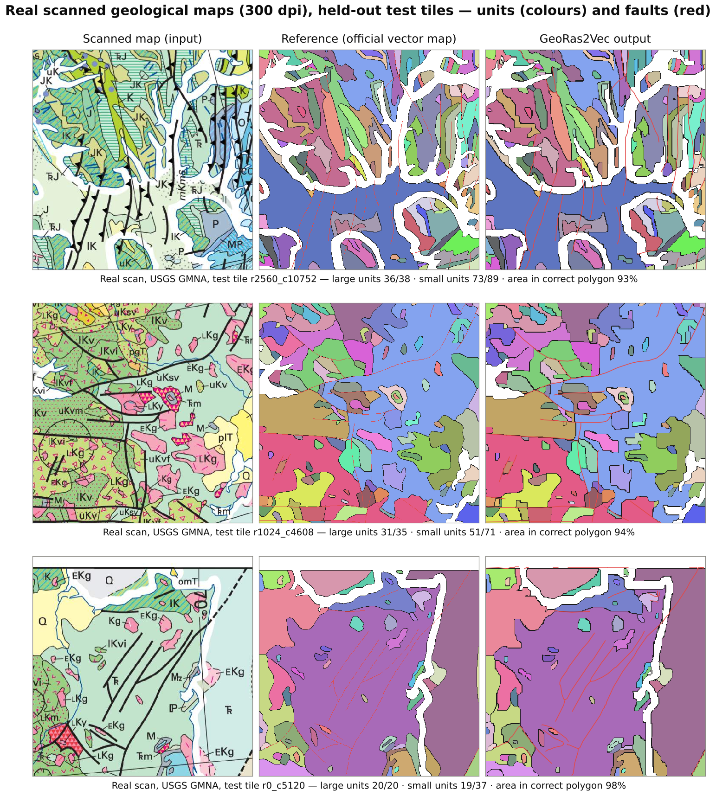
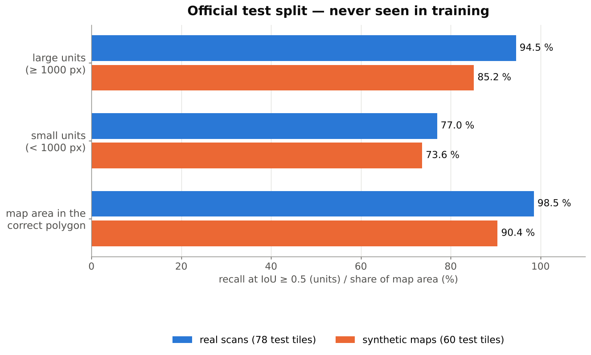
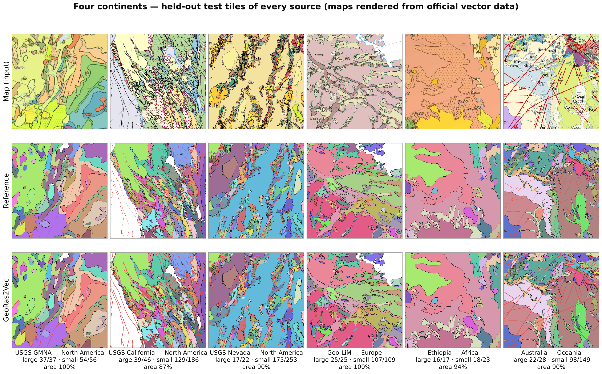
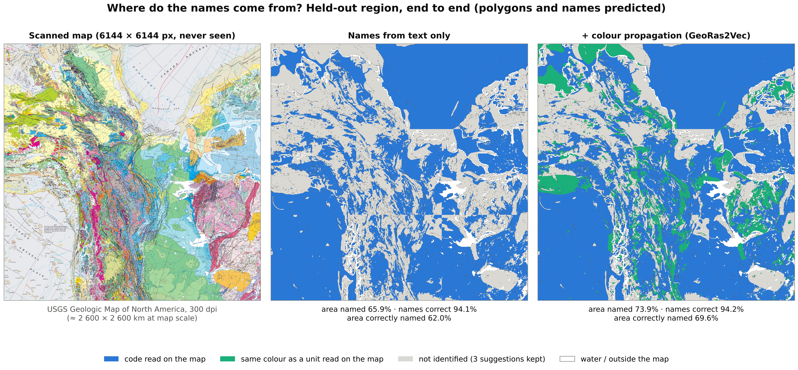
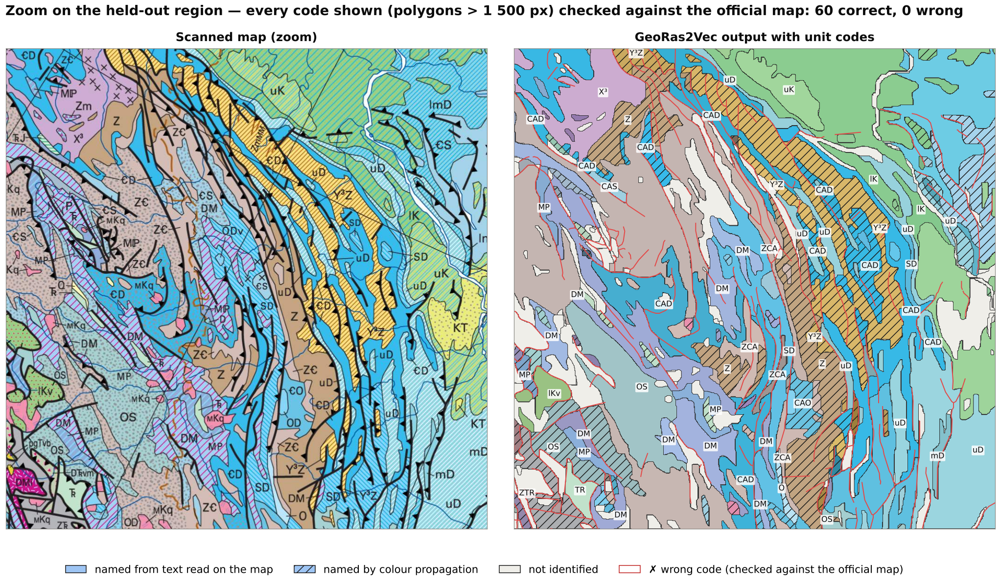
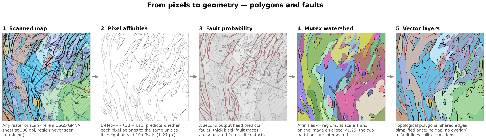
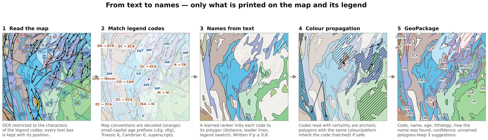
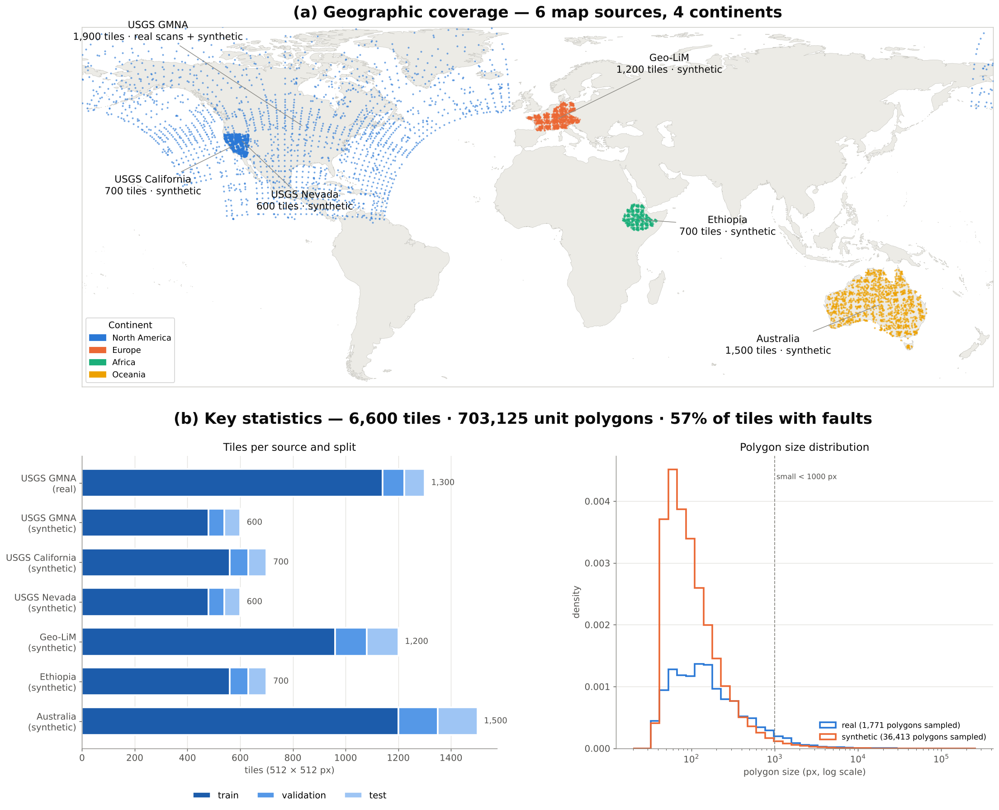
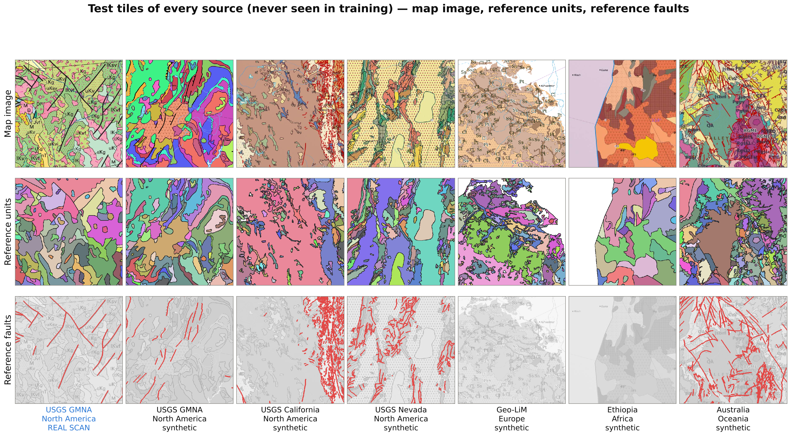

<div align="center">

# GeoRas2Vec

### Scanned geological map → GIS vector map. Units, faults and names, in one command.

**Raster in, GeoPackage out** (QGIS / ArcGIS): polygons of geological units, fault lines, and unit names read
**only from the map itself and its legend**.

[](https://huggingface.co/PerfectWin/georas2vec-model)
[](https://huggingface.co/datasets/PerfectWin/georas2vec)


</div>



---

## Why

Millions of geological maps exist only as paper sheets or scans. Turning one of them into a GIS layer is still
done **by hand**: digitising every contact and every fault, then typing every unit code. That takes days to weeks per sheet.
GeoRas2Vec does it automatically and records, for every name it writes, **where the name comes from and how sure it is**.

## What you get

One **GeoPackage** that opens directly in QGIS, with styles already applied:

| layer | content |
|---|---|
| `unites_geologiques` | one polygon per unit: `code`, `nom`, `age`, `lithologie`, `source_nom` (how the name was found), `confiance`, `texte_lu` (text read on the map), `suggestions` (top-3 when not sure), map colour, area |
| `failles` | fault traces as lines |
| `legende` | the legend entries used |

Geometries are valid, polygons have **no gaps and no overlaps** (shared boundaries are simplified once,
topologically), and the QGIS styles are embedded in the file.

## Results

Every number below is measured on data **never seen during training**: spatially separated test blocks and a
held-out map region.

### Polygons and faults



| official test split | large units | small units | map area in the correct polygon |
|---|---|---|---|
| real scans (78 tiles, USGS GMNA 300 dpi) | **94.5 %** | **77.0 %** | **98.5 %** |
| synthetic maps, 4 continents (60 tiles) | 85.2 % | 73.6 % | 90.4 % |

<sub>A reference unit is recovered when a predicted polygon matches it with IoU ≥ 0.5. Small = &lt; 1000 px.</sub>

**Faults**: line-level F1 at 2 px tolerance is **0.80** on the real-scan test split and **0.85** on a held-out region.



### Names

End to end on a held-out 6144 × 6144 px region of the USGS *Geologic Map of North America*
(polygons and names both predicted):

| | area named | names correct | area correctly named |
|---|---|---|---|
| names from text only | 65.9 % | 94.1 % | 62.0 % |
| **+ colour propagation (GeoRas2Vec)** | **73.9 %** | **94.2 %** | **69.6 %** |





## How it works



1. **Segmentation**: a U-Net++ (EfficientNet-B4) reads RGB + CIE-Lab. For every pixel it predicts whether the
   pixel belongs to the same unit as its neighbours at 10 offsets (1–27 px). It also predicts a fault probability map.
2. **Polygons**: a mutex watershed turns the affinities into regions. It runs twice, at scale 1 and on the image
   enlarged ×1.25, and the two partitions are intersected. Scale 1 separates large units; the enlarged scale finds
   small ones.
3. **Faults**: the fault map is skeletonised, split at junctions and traced into ordered lines.
4. **Vectorisation**: shared boundaries are noded and simplified once for the whole map, so there are no gaps
   and no overlaps.



5. **Reading the map**: OCR is restricted to the characters of the legend codes. Codes are decoded with the
   conventions of geological maps: small-capital age prefixes ʟ/ᴇ, Triassic Ʀ, Cambrian Є and superscripts.
6. **Naming**: a gradient-boosting ranker links each code to its polygon from distance, leader lines and the
   colour of the legend swatch. A name is written only when confidence is ≥ 0.8.
7. **Colour propagation**: a unit is usually labelled on only a few of its polygons. Codes read with certainty
   become *anchors*. A polygon with the same colour and pattern anywhere on the map receives that code when a
   second learned model judges the match safe. These names are flagged
   `source_nom = "même couleur qu'une unité lue sur la carte"`, so you always know where a name comes from.
8. **Export**: the result is a GeoPackage with embedded QGIS styles. Polygons that cannot be named stay
   *Unité non identifiée* and keep 3 suggestions. **GeoRas2Vec never writes a code that is not printed on the
   map or its legend.**

Large maps are processed in blocks of 2048 px, so memory stays bounded. Propagation and the merging of
neighbouring polygons with the same code run over the whole map at once.

## Quick start

```bash
git clone https://github.com/PerfectWin7777/georas2vec.git
cd georas2vec
pip install -r requirements.txt
python scripts/vectorize.py my_map.tif my_legend.csv my_map.gpkg
```

- `my_map.tif` must be georeferenced (any CRS).
- `my_legend.csv` has one row per legend entry: `code` (as printed on the map), optional `nom`, `age`,
  `lithologie`, and either the pixel box of the legend swatch (`x0,y0,x1,y1`, recommended) or its colour
  (`couleur_hex`). See [`examples/legende_exemple.csv`](examples/legende_exemple.csv).
- The model files (≈ 45 MB) are downloaded once from
  [Hugging Face](https://huggingface.co/PerfectWin/georas2vec-model). To work offline, put them in a folder and
  pass `--assets that_folder`.
- `tests/qgis_check.py out.gpkg render.png` checks a GeoPackage with PyQGIS: layers, styles, geometry validity,
  overlaps and rendering.

A 2048 × 2048 px map takes about 3 minutes on a laptop CPU.

## Training data



[PerfectWin/georas2vec](https://huggingface.co/datasets/PerfectWin/georas2vec) contains 6 600 tiles of
512 × 512 px from **4 continents**. Each tile has pixel-exact unit instances and faults. Two kinds of tiles are
mixed:

- real USGS GMNA scans;
- official vector maps from 6 sources, rendered as realistic printed-and-scanned geological maps.

The code that builds the tiles is in [`dataset/`](dataset/).



## Repository layout

| folder | content |
|---|---|
| `georas2vec/` | the pipeline: network, mutex watershed, vectorisation, OCR and naming, propagation, GeoPackage export |
| `scripts/vectorize.py` | command-line tool |
| `tests/` | PyQGIS check of a produced GeoPackage |
| `dataset/` | builds the training tiles (real scans and synthetic rendering) |
| `training/` | network training (`train.py`) and every evaluation used for the numbers above (`eval/`) |
| `docs/img/` | figures |

## Limitations

- **Names**: a unit whose code is never printed (or never readable) on the map stays unnamed.
- **Similar colours**: sibling units with almost the same colour are hard to separate without text, for example
  `lK` and `K`, or the pale yellows of Quaternary and Tertiary. Most propagation errors come from such pairs.
- **Slivers**: very small polygons (&lt; ~40 px) and thin slivers along boundaries.
- **Block edges**: on large maps, unnamed areas can show straight cuts at the 2048 px block edges. Overlapping
  blocks are planned.
- **Coverage**: evaluated mostly on North-American real scans. Other map series may need a legend CSV with
  swatch boxes.

## Citation

```bibtex
@misc{tony2026georas2vec,
  title  = {GeoRas2Vec: from scanned geological maps to vector units, faults and names},
  author = {Winter Tony},
  year   = {2026},
  url    = {https://github.com/PerfectWin7777/georas2vec}
}
```

## Author

**Winter Tony**
