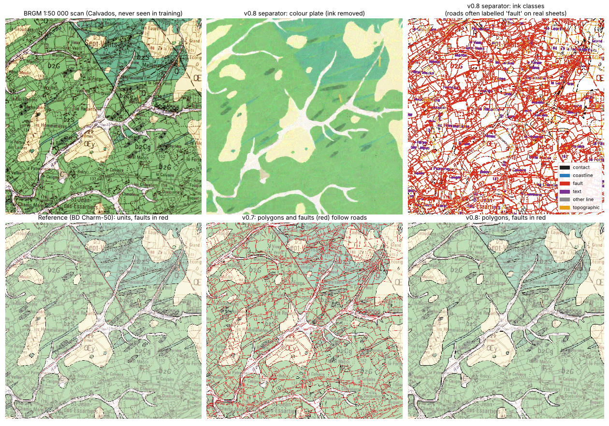

# GeoRas2Vec — experiment log: generalising to detailed maps with a topographic background

This document records **every training run and diagnostic** carried out after v0.7, while trying to make one model
work on two kinds of scanned geological maps:

- **small-scale overview maps** (USGS *Geologic Map of North America*, GMNA): units are separated by thin black
  contact lines, there is no topographic background;
- **detailed maps** (BRGM 1:50 000, France): units are printed over a full topographic base map (contour lines,
  roads, field boundaries, buildings, place names); faults are thin black lines that look like roads.

All numbers, including failed runs, are reported. The outcome is the **layer-separation model released as
v0.8** (§ 5); v0.7 stays available as revision `v0.7` of the model repository.

---

## 1. Test protocol (frozen before the runs)

| test set | content | why |
|---|---|---|
| **USGS official** | the 78 real-scan tiles of the official test split (GMNA, 300 dpi, 512 × 512 px) | main benchmark, real scans |
| **Synthetic, 4 continents** | 672 rendered tiles of the test split | no regression elsewhere |
| **BRGM Calvados** | 3 windows of 2048 × 2048 px (8.6 km, ≈ 4.2 m/px) of the 1:50 000 scan of département 014, truth = BD Charm-50 | unseen map series; Calvados and its neighbours (050, 061, 027) never used for training |

All models are evaluated with **the published inference chain** (mutex watershed at scale 1 and ×1.25, fused;
faults skeletonised and vectorised): `training/usgs_cmp.py`, `training/brgm_test.py`.

Metrics:

- **large / small**: share of reference units recovered by one predicted polygon with IoU ≥ 0.5, for units
  ≥ 1000 px / < 1000 px;
- **area**: share of the map area that lies in a correctly recovered polygon;
- **fault F1**: line-level F1 at 2 px tolerance between vectorised predicted faults and the reference fault lines.

BRGM reference: a unit instance = a connected component of one `NOTATION` value of `S_FGEOL`, minimum mapping unit
40 px; faults = lines whose `DESCR` contains "faille" in `L_STRUCT` **and** `L_FGEOL`.

**Adoption rule** (fixed in advance): USGS official regression ≤ 0.5 point; no regression on the synthetic test;
clear improvement on BRGM Calvados; naming on the held-out Greenland zone stable.

## 2. New training data

- **Real BRGM tiles** (`training/brgm_tiles.py`): scans from the BRGM WMS layer `SCAN_D_GEOL50` (EPSG:2154,
  8600 m windows rendered at 2048 px), labels from BD Charm-50 vectors. Training départements: 029, 021, 007, 038,
  063, 009, 068, 084. An alignment check keeps a window only if ≥ 55 % of the vector boundary pixels fall within
  2 px of a strong colour edge of the scan. Windows are cut into 512 px tiles with the same columns as the
  Hugging Face dataset.
- **Synthetic topographic background** (`training/topo_aug.py`): contour lines (brown, index contours thicker),
  field boundaries and hedges, roads (double lines, coloured fill), tracks, villages, place names, spot heights, road
  numbers, kilometre grid — drawn **over** a tile; labels unchanged.
- **Thin-black-fault restyling** (`topo_aug.restyle_faults`): redraws the reference faults as thin black, sometimes
  dashed lines. Tested once, rejected (it cost 0.09 fault F1 on USGS).

## 3. Runs

All runs: U-Net++ EfficientNet-B4 (RGB + Lab), 10 affinity offsets + fault channel, Kaggle T4.
"Real USGS" = share of real GMNA tiles per batch; "BRGM" = share of real BRGM tiles; "topo" = probability of the
topographic background augmentation.

| run | init | steps | batches | topo | other |
|---|---|---|---|---|---|
| **v0.7** (published) | ImageNet | 22 500 (best) | 35 % real USGS, 65 % synthetic | – | – |
| fine-tune topo | v0.7 | short | as v0.7 | yes | – |
| full retrain topo+faults | ImageNet | 30 000 | as v0.7 | 50 % | thin-black-fault restyle 30 % |
| short mix | v0.7 | 4 000 | + BRGM tiles in the pool | 25 % | – |
| joint (both map kinds) | ImageNet | 30 000 | 35 % USGS, 15 % BRGM, 50 % synthetic | 25 % | – |
| ft07 | v0.7 | 8 000, LR 1e-4 | 35 % USGS, 5 % BRGM | 25 % | BRGM units < 1500 px masked out of the loss |
| seed | ImageNet | 30 000 | exactly the v0.7 recipe | – | random seed 1 instead of 0 |
| film | ImageNet | 30 000 | 35 % USGS, 15 % BRGM | 25 % | map-style FiLM + ±2 px boundary tolerance band on BRGM |
| film2 | ImageNet | 30 000 | 35 % USGS, 15 % BRGM | 25 %, synthetic only | map-style FiLM, no tolerance band |

### 3.1 Results

| run | USGS large | USGS small | USGS area | USGS faults F1 | BRGM large | BRGM small | BRGM area | BRGM faults F1 | verdict |
|---|---|---|---|---|---|---|---|---|---|
| **v0.7** | **94.5** | 77.0 | **98.5** | **0.783** | **83.1** | **63.4** | 70.4 | 0.07 | reference |
| seed (v0.7 recipe, seed 1) | 93.9 | **78.7** | 98.4 | 0.763 | 81.4 | 60.7 | 69.2 | 0.07 | run-to-run noise |
| full retrain topo+faults | 93.5 | 75.7 | 97.6 | 0.694 | 88.3 | 64.6 | 89.2 | 0.07 | rejected |
| short mix | 92.7 | 75.6 | 98.0 | 0.773 | 78.1 | 38.1 | 85.0 | 0.48 | rejected |
| joint (both map kinds) | 92.1 | 75.4 | 97.9 | 0.758 | 82.0 | 47.1 | **90.8** | **0.56** | rejected |
| ft07 | 92.0 | 74.8 | 97.9 | 0.757 | 74.8 | 32.5 | 81.5 | 0.42 | rejected |
| film | 91.9 | 74.7 | 97.8 | 0.769 | 28.8 | 9.0 | 30.6 | 0.53 | rejected (design bug) |
| film2 | 90.7 | 71.4 | 97.0 | 0.767 | 75.3 | 25.3 | 87.4 | 0.51 | rejected |

Percentages; F1 in [0, 1]. An earlier short topo fine-tune reached BRGM large 86.9 / area 83.8 with the
older, incomplete fault reference (L_STRUCT only); not comparable for faults.

### 3.2 What the runs show

1. **v0.7 is reproducible.** Re-training the same recipe with another seed moves the scores by ≈ 0.6 point
   (large units) and 1.7 points (small units). The adoption threshold of 0.5 point is at the noise level; a drop
   of ≥ 2 points is real.
2. **Every model trained on both map kinds loses ≈ 2 points on USGS**, whatever the dosage (5 % or 15 % BRGM),
   the initialisation (v0.7 or ImageNet) or the conditioning (FiLM on the map style).
3. **Real BRGM tiles are what make French faults detectable** (F1 0.07 → 0.42–0.56). Synthetic topographic
   background alone does not (0.07), nor does redrawing faults in thin black.
4. **The topographic augmentation mostly fixes the area metric on BRGM** (70 → 89–91 %): v0.7 over-segments
   along roads and contour lines.
5. **Small BRGM units get worse when BRGM tiles are trained on** (63 → 25–47 %). The BRGM truth is imperfect for
   small units (vector/scan misalignment, generalisation of the 1:50 000 vectors) and the network learns it.
6. **Conditioning on the map style (FiLM) does not remove the conflict.** With the correct style given at training
   time and a learned style classifier at test time, USGS still drops 2.6–3.8 points.
7. **Boundary tolerance bands destroy short-range affinities.** Masking ±2 px around BRGM boundaries for the short
   offsets removed all supervision of where to cut: the BRGM output collapsed into a few merged regions (area
   30.6 %). Do not mask the boundary itself.

## 4. Diagnostic: what does the network actually look at?

`training/eval/usgs_diag.py` re-runs the USGS official test after transforming the input:

- **ink erased**: dark, low-chroma pixels (L* < 45, chroma < 18, dilated by 1 px) are removed and inpainted
  (OpenCV Telea);
- **topographic background added**: `topo_overlay` with strength 0.8 on every tile.

| condition | model | large | small | area | faults F1 |
|---|---|---|---|---|---|
| original | v0.7 | 94.5 | 77.0 | 98.5 | 0.78 |
| ink erased | v0.7 | 81.6 | 62.3 | 92.2 | 0.02 |
| ink erased | joint | 80.7 | 61.1 | 92.6 | 0.02 |
| topo added | v0.7 | 85.5 | 73.0 | **73.7** | **0.44** |
| topo added | joint | 90.4 | 72.0 | 96.5 | 0.75 |

Erasing ink also removes the fault lines (hence F1 ≈ 0) and slightly blurs the colours along lines; some
dark-grey units may be partly erased. The 13–15 point drop is too large to be explained by that alone.

**Interpretation.** On USGS maps the contacts are printed as thin black lines, and the network has learned the
shortcut *thin black line = unit boundary*. Without the lines it loses 13–15 points even though the unit colours
are intact. On detailed maps most thin black lines are roads and field boundaries, so the same local evidence has
the opposite meaning. A convolutional network deciding from a local window cannot resolve this; mixing the two
map kinds forces a compromise that loses on both (§ 3). The joint model is robust to the topographic background (96.5 % area)
but pays for it on clean maps.

The question the network must answer is non-local: *does the colour change across this line, does the line close
a region of another colour, does it look like the other roads of this sheet?*

## 5. Layer separation (work in progress)

### 5.1 Idea

A printed map is a stack of layers: colour plate (units and patterns), black linework (contacts, faults),
topographic base, text. GeoRas2Vec v0.8 first **separates the layers**, then segment:

- **(A) separator**: image → clean colour plate (the map as if no ink had been printed) + per-pixel ink class
  (none, contact, coastline, fault, text, other line, topographic background);
- **(B) segmenter**: reads image + plate + ink probabilities (16 channels) and keeps the v0.7 architecture.

Its first convolution is initialised from v0.7 with zero weights on the 10 new channels, so training **starts
exactly from v0.7** (checked: identical outputs) and can only learn to use the new evidence.

### 5.2 Exact training pairs from the renderer

`dataset/build_tiles.py` → `render_map(..., layers=True)` additionally returns the colour plate (same printing,
blur, paper tint, noise and JPEG as the map, but no ink) and the ink class map. Random draws are identical to
`layers=False`, so published tiles are unchanged (verified on 6 tiles of 2 sources). `training/build_layers.py`
writes the layered dataset; half of the tiles also receive the topographic background (ink class 6).

### 5.3 CPU proof of concept (ResNet-18 separator, 1 125 tiles, 3 000 steps, 62 min CPU)

| | value |
|---|---|
| plate error on ink pixels (mean abs., 0–255) | 79.3 (raw image) → **16.5** |
| ink-class IoU | none 0.82, contact 0.44, coast 0.22, fault 0.45, text 0.19, other line 0.00, topographic 0.48 |

Using the separator as a **pre-processing cleaner** (topographic ink replaced by the predicted plate, v0.7 unchanged):

| test | v0.7 | v0.7 + cleaner |
|---|---|---|
| USGS + topo added | 85.5 / 73.0 / 73.7 / 0.44 | 81.9 / 72.6 / 75.8 / 0.45 |
| USGS original | 94.5 / 77.0 / 98.5 / 0.78 | 94.2 / 76.2 / 98.4 / 0.78 |
| BRGM Calvados | 83.1 / 63.4 / 70.4 / 0.07 | 81.4 / 60.9 / 72.7 / 0.07 |

large / small / area / fault F1.

The plate is reconstructed well, but hard cleaning is not enough: half of the topographic ink is missed and the
mistakes become final. Hence the next step feeds the **probabilities** to the segmenter and trains it (§ 5.1).

### 5.4 Training of the layered model (Kaggle `georas2vec-layers`)

- separator: U-Net ResNet-34, 8 000 steps, crops 384, batch 16, on the full layered dataset (≈ 2 400 tiles,
  6 sources);
- segmenter: 16-channel v0.7 (initialised from v0.7), 20 000 steps, LR 2e-4, batches 35 % real USGS, 10 % BRGM,
  rest synthetic, topographic background 25 %; separator frozen;
- evaluation: the frozen protocol of § 1 plus the "topo added" USGS condition of § 4.

### 5.5 Result: the layered model, released as v0.8 (Kaggle `georas2vec-layers`, 5.5 h T4)

Separator (validation, 240 rendered tiles): plate error on ink pixels 82.0 → **13.9**; ink-class IoU none 0.88,
contact 0.56, coast 0.32, fault 0.63, text 0.48, other line 0.22, topographic 0.64 (CPU proof of concept: 16.5 and
0.44 / 0.45 / 0.48 for contact / fault / topographic).

| test | v0.7 | joint training | **v0.8 (layers)** |
|---|---|---|---|
| USGS official | **94.5** / 77.0 / **98.5** / **0.783** | 92.1 / 75.4 / 97.9 / 0.758 | 93.0 / **77.4** / 98.0 / 0.778 |
| USGS + topo added | 85.5 / 73.0 / 73.7 / 0.44 | 90.4 / 72.0 / 96.5 / 0.75 | 89.1 / **75.2** / **96.9** / **0.78** |
| BRGM Calvados | **83.1** / **63.4** / 70.4 / 0.07 | 82.0 / 47.1 / **90.8** / **0.56** | 82.9 / 42.7 / 90.0 / 0.45 |

large / small / area / fault F1. Synthetic test (672 tiles, notebook metric): area 92.3 %, no regression.

- **Best compromise so far.** On clean USGS maps the loss shrinks from 2.4 to 1.5 points (large units), small units
  and faults are unchanged. With a topographic background the model keeps 96.9 % of the area and its fault F1 does
  not move at all (0.78 with and without background), whereas v0.7 falls to 0.44.
- **Released as v0.8 although it does not meet the frozen rule** (USGS large −1.5 > 0.5; BRGM small units
  63.4 → 42.7). Decision: one model that works on both kinds of maps is worth 1.5 points on clean overview maps,
  given the gain on maps with a topographic background (area 73.7 → 96.9 %, fault F1 0.44 → 0.78). v0.7 remains
  available (`GEORAS2VEC_REVISION=v0.7`).
- **On real sheets the ink classes are only partly right** (figure below): the colour plate is clean, but many roads
  are labelled *fault*. The segmenter is not misled (its faults follow the real faults), because it also sees the
  image and the plate; the synthetic topographic background is still less varied than real base maps.

- The remaining BRGM weakness is the small units, the same failure as every run trained on BRGM tiles (§ 3.2, point 5):
  it points to the BRGM reference for small units rather than to the architecture.

## 6. Questions a reader may ask

**Why not train one bigger network on everything?** Runs joint, ft07, film and film2 show that the loss on USGS
is systematic (≈ 2 points) and does not depend on dosage or initialisation; § 4 shows why: the same visual sign
(thin black line) has opposite meanings in the two map kinds.

**Why not a router between two models?** It works (v0.7 for overview maps, the joint model for detailed maps would give
94.5 % USGS and 90.8 % BRGM area), but it hides the problem instead of solving it and does not extend to a third
map series. We keep it as a baseline.

**Is the 2-point drop just noise?** No: the seed run measures the noise at ≈ 0.6 point (large units).

**Why are BRGM small units hard?** The BD Charm-50 vectors are generalised and not perfectly aligned with the
scans; units < 1000 px are where a few pixels of misalignment change the IoU most. Their recall drops whenever
BRGM tiles are trained on.

**Would a spectral/Fourier operator (e.g. U-FNO) help?** Unlikely: Fourier layers keep low frequencies, while
the task depends on 1–2 px lines and small polygons. Global context is useful, but through attention on the colour
plate, not through spectral truncation.

**Are the synthetic topographic backgrounds realistic?** They are procedural (no real base map). The diagnostic
of § 4 uses the same generator, so the "topo added" numbers measure robustness to this generator; BRGM Calvados is
the real-world check.

## 7. Reproducing

| step | script / notebook |
|---|---|
| BRGM tiles | `training/brgm_tiles.py 029 021 007 038 063 009 068 084`, `--test 014` |
| USGS official test | `training/usgs_cmp.py name=weights.pt ...` |
| BRGM Calvados test | `WEIGHTS=weights.pt training/brgm_test.py` (`SEP_REMOVE=6` to add the cleaner) |
| ink / topo diagnostic | `GC_XFORM=erase|topo|clean|topo_clean training/eval/usgs_diag.py name=weights.pt` |
| layered dataset | `training/build_layers.py 400` |
| separator (CPU) | `training/train_separator.py` |
| training runs | `training/kaggle/*.ipynb` (one notebook per run of § 3: `georas2vec-mix-test`, `-joint`, `-ft07`, `-seed`, `-film`, `-film2`; v0.8 = `georas2vec-layers`) |
